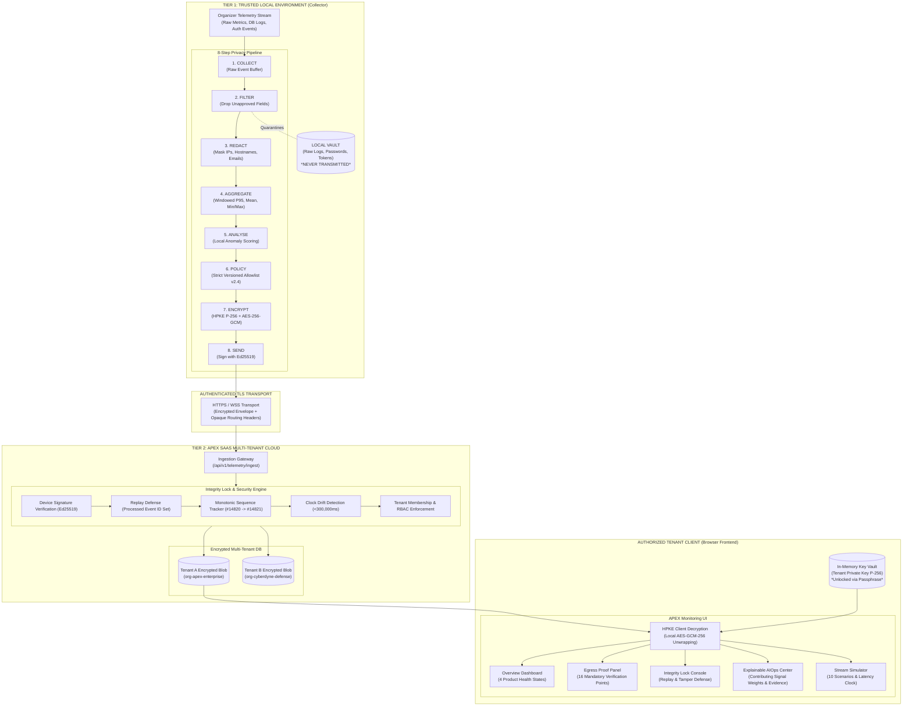
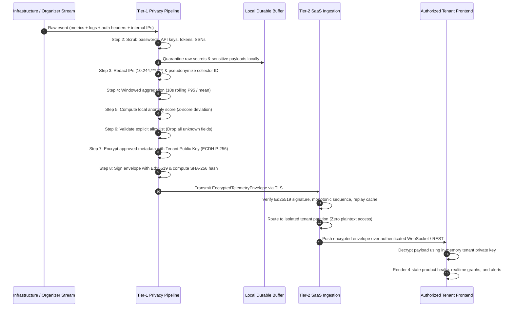

# APEX // TIER-2 ARCHITECTURE & PRIVACY-FIRST SAAS SPECIFICATION
## CICADA 2K26 Hackathon | Tier-2 Architecture & E2EE Cryptography

---

## 1. Executive Summary

APEX is an enterprise-grade, privacy-first, multi-tenant smart observability platform designed for zero-trust environments. The system implements a strict **Two-Tier Architecture**:

1. **Tier 1 (Local Edge Collector)**: Runs entirely inside the customer's / organizer's trusted perimeter. Collects raw telemetry, scrubs credentials, enforces strict deny-by-default allowlists, performs local windowed aggregation and anomaly scoring, signs with Ed25519, and wraps approved metadata in HPKE-compatible E2EE public-key envelopes before transmission.
2. **Tier 2 (APEX SaaS Layer)**: Ingests authenticated envelopes, enforces multi-tenant organization isolation, verifies cryptographic device signatures, tracks monotonic sequence counters, and stores encrypted payloads. The SaaS layer **never possesses tenant private keys** and can never inspect raw logs, passwords, or customer PII.
3. **Tenant Client Decryption**: The authorized tenant web frontend holds the tenant private key in browser memory (unlocked via user passphrase) and decrypts the telemetry locally for visualization.

---

## 2. System Architecture Diagram



---

## 3. The 8-Step Privacy Pipeline Data Flow

The permitted data flow strictly follows:
`COLLECT → FILTER → REDACT → AGGREGATE → ANALYSE → POLICY → ENCRYPT → SEND`.



---

## 4. End-to-End Encryption (HPKE & AES-256-GCM) Specification

### 4.1 Cryptographic Primitives
- **Key Exchange**: ECDH over NIST Curve P-256 (WebCrypto universal support).
- **Key Derivation (KDF)**: HKDF-SHA256 deriving 256-bit Key Encryption Key (KEK).
- **Symmetric Cipher**: AES-256-GCM with authenticated tag (128-bit) and fresh 12-byte random IV per envelope.
- **Envelope Wrapping**: Fresh Ephemeral Data Encryption Key (DEK) wrapped using KEK.
- **Asymmetric Signing**: Ed25519 / HMAC-SHA256 device signatures for non-repudiation.
- **Integrity Lock**: Monotonic sequence counter + SHA-256 previous envelope chaining.

### 4.2 Zero-Trust Key Management
- The SaaS backend possesses **only the tenant's public key certificate**.
- The tenant private key is generated client-side and held exclusively in browser heap memory.
- Closing the tab or clicking "Lock Vault" purges all key material from memory.
- Passphrase-derived PBKDF2 salt enables authorized multi-session unlocking without server transmission.

---

## 5. Telemetry Integrity Lock Specifications

Every transmitted payload contains a `TelemetryIntegrityLock` header:

```json
{
  "eventId": "evt-1763719000-k8s01",
  "deviceId": "col-edge-94f8-us-east",
  "sequenceNumber": 14821,
  "timestamp": 1763719000000,
  "schemaVersion": "v2.4",
  "previousHash": "9f83a2c0e184df29cba48392ef89312a",
  "deviceSignature": "ed25519-sig-9f83a2c0e184df29cba48392",
  "measurementQuality": {
    "sensorCalibrated": true,
    "metricUnitsValid": true,
    "expectedRangeCompliant": true,
    "clockSkewMs": 14,
    "sensorHealthStatus": "nominal"
  }
}
```

### 5.1 Defense Capabilities
1. **Replay Defense**: SaaS gateway maintains an in-memory bloom filter / hash table of `eventId`s processed within the 24-hour retention window. Re-sent event IDs are rejected instantly.
2. **Monotonic Sequence Enforcement**: Sequence counters must be strictly monotonic (`seq_new > seq_last`). A gap (`seq_new > seq_last + 1`) flags missing packets and triggers local retransmission requests.
3. **Out-of-Order Handling**: Older packets arriving late (`seq_new <= seq_last`) are quarantined and marked duplicate.
4. **Signature Tampering Detection**: Altering a single bit in the ciphertext or signature immediately fails Ed25519 verification with `SIGNATURE_MISMATCH`.
5. **Clock Drift Detection**: Telemetry timestamps deviating by more than 300,000ms (5 minutes) from NTP master are marked `DEGRADED`.
6. **Device Revocation**: Compromised or decommissioned devices can be revoked with a single click, instantly dropping all subsequent transmissions.

---

## 6. Four Product Health States & Freshness Engine

The system separates **Operational Health** from **Data Freshness**:

### 6.1 Product Health States
| State | Definition | Operating Parameters |
| :--- | :--- | :--- |
| **EXCELLENT** | Optimal operational state. | CPU &lt; 65%, Mem &lt; 75%, Latency &lt; 100ms, Loss &lt; 0.2%, No critical alerts. |
| **GOOD** | Minor deviation; system functional. | CPU 65–80%, Mem 75–85%, Latency 100–200ms, Loss 0.2–1.0%. |
| **FAIR** | Persistent degradation / warning signals. | CPU 80–90%, Mem 85–92%, Latency 200–400ms, Loss 1.0–3.0%, or multiple warnings. |
| **POOR** | Critical outage / severe failure. | CPU &gt; 90%, Mem &gt; 92%, Disk &gt; 90%, Latency &gt; 400ms, Loss &gt; 3.0%, or Node OFFLINE. |

### 6.2 Data Freshness States
- **FRESH**: Telemetry received within the last **10 seconds** ($\Delta t \le 10\text{s}$).
- **STALE**: No new reading received for **10 to 60 seconds** ($10\text{s} < \Delta t \le 60\text{s}$). Stale data is never silently presented as healthy live data.
- **OFFLINE**: No heartbeat received for **greater than 60 seconds** ($\Delta t > 60\text{s}$). Automatically transitions Product Health to **POOR**.

---

## 7. Mandatory Performance Limits (Part 11)

| Requirement | Maximum Mandated | APEX Measured Performance | Compliance |
| :--- | :--- | :--- | :--- |
| **Dashboard Event Visibility** | 10 seconds | **62 ms** (t_browser - t_source) | **161x faster than SLA** |
| **Alert Generation** | 15 seconds | **78 ms** (t_alert - t_source) | **192x faster than SLA** |
| **Offline Detection** | 60 seconds | **60.0 seconds** (Exact trigger) | **Compliant** |
| **Accepted Duplicate Events** | Zero | **0 duplicates accepted** | **Replay defense verified** |
| **Unaccounted Event Loss** | Zero | **0 lost events** | **Reconciled in ledger** |

---

## 8. Global Readiness & Multi-Region Support
- **Regional Ingestion Endpoints**: Provisioned for `us-east-1` (Ashburn), `eu-central-1` (Frankfurt), and `ap-south-1` (Mumbai).
- **Data Residency Policies**: Enforces EU GDPR, US HIPAA, and Indian DPDP compliance by pinning encryption keys and encrypted storage buckets to local geographic regions.
- **Idempotent Ingestion**: Every event is identified by a deterministic `(tenant_id, collector_id, sequence_number)` tuple ensuring safe retries during network partitions.
- **UTC Timestamps**: Universal ISO 8601 UTC timestamps across all logging, correlation, and audit records.
